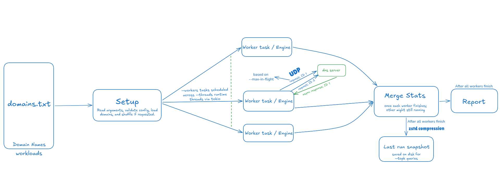
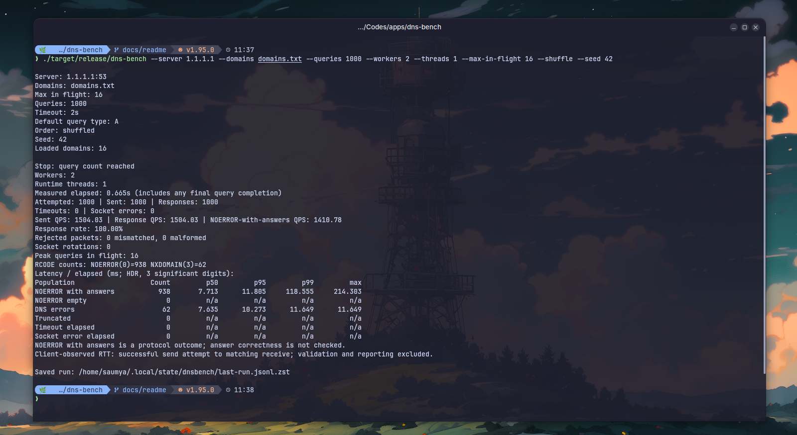
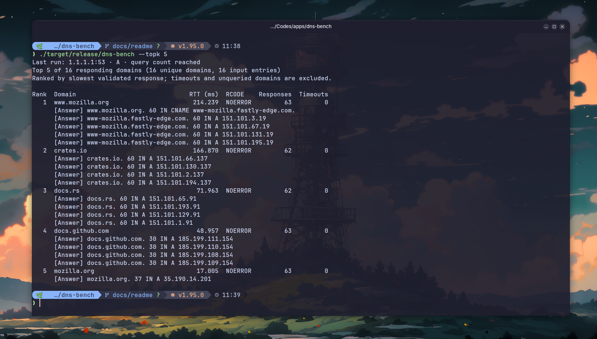

# dnsbench

A DNS benchmark CLI written in Rust. Send queries to a DNS server, measure response times, and inspect the slowest domains from your last run.

## Flow



## Features

- UDP queries for A, AAAA, NS, MX, TXT, SOA, CNAME, and PTR records over IPv4 or IPv6.
- Configurable workers, runtime threads, query limits, and timeouts.
- Query each input entry once, send a fixed number of queries, or run for a duration.
- Latency percentiles, throughput, DNS response codes, timeouts, and socket errors.
- Reproducible domain shuffling with a seed.
- Compressed run snapshots and offline inspection of slowest domains and their DNS records.

## Build

Requires a current stable Rust toolchain and a C compiler for the compression dependency.

```sh
cargo build --release --locked
```

The executable is `target/release/dns-bench`.

## Usage

Create `domains.txt` with one domain per line. Blank lines and lines starting with `#` are ignored.

```text
example.com
rust-lang.org
```

Query each entry once:

```sh
./target/release/dns-bench --server 1.1.1.1 --domains domains.txt
```

Send 10,000 queries with a larger window:

```sh
./target/release/dns-bench --server 1.1.1.1 --domains domains.txt \
  --queries 10000 --max-in-flight 128 --workers 4 --threads 2
```

`--queries` is the total across all domains. Use `--duration 30s` instead to run for a duration. Both modes cycle through the workload. Pending queries finish or time out after sending stops.

| Option | Meaning | Default |
| --- | --- | --- |
| `--max-in-flight` | Total outstanding queries across workers | `2` |
| `--workers` | Logical workers, each owning a UDP socket | `2` |
| `--threads` | Tokio runtime threads | `1` |
| `--timeout` | Per-query timeout | `2s` |
| `--type` | `A`, `AAAA`, `NS`, `MX`, `TXT`, `SOA`, `CNAME`, or `PTR` | `A` |
| `--shuffle --seed 42` | Repeat a seeded permutation of the input | Off |

Workers must not exceed max in flight. Server addresses accept an optional port, defaulting to `53`. Run `--help` for all options.

Use `--type MX` for mail servers or `--type TXT` for text records. Query types are case-insensitive. PTR workloads must contain reverse DNS names, such as `1.2.0.192.in-addr.arpa` for `192.0.2.1`.

Saved results decode all supported record types, including MX preferences, SOA fields, and separate quoted TXT strings. Truncated UDP responses are reported without a TCP retry.

## Docker

```sh
docker build -t dnsbench .
mkdir -p data
docker run --rm \
  -v "$(pwd)/domains.txt:/domains.txt:ro" \
  -v "$(pwd)/data:/state" \
  dnsbench --server 1.1.1.1 --domains /domains.txt
```

Snapshots are saved in `data/dnsbench/`. Inspect the saved run:

```sh
docker run --rm --network none \
  -v "$(pwd)/data:/state:ro" \
  dnsbench --topk 2
```

## Inspect a run

Each run saves a compressed snapshot after measurement finishes. Inspect the two slowest responding domains without sending more queries:

```sh
./target/release/dns-bench --topk 2
```

Domains are ranked by their slowest recorded response. Duplicate domain entries are combined, and domains without a response are excluded. `--topk 0` produces no output.

The save location is printed after each run. Use `--results-file PATH` when benchmarking or inspecting to select another snapshot. The default snapshot is replaced by the next run.

Response latency measures the interval from the successful send attempt to receiving a matching response. Validation and reporting follow the receive timestamp. Scheduling and socket queueing can still affect the observed latency.

## Public resolver comparison

Sample from one Linux host on 2026-10-25: 100 domain names, three 1,000-query runs per provider and query type, 4 workers, 2 threads, and 32 in-flight queries.

Latency pairs are p50 / p99 in milliseconds, each the median of three run-level values for NOERROR responses with answers. Timeouts are totals per 3,000 queries for each type.

| Provider | Server | A p50 / p99 | AAAA p50 / p99 | Timeouts A / AAAA |
| --- | --- | ---: | ---: | ---: |
| Cloudflare | `1.1.1.1` | 8.495 / 149.422 | 8.110 / 158.466 | 0 / 2 |
| Google | `8.8.8.8` | 26.640 / 423.887 | 31.457 / 409.207 | 32 / 30 |
| Quad9 | `9.9.9.9` | 20.972 / 536.347 | 19.956 / 389.808 | 2 / 7 |
| OpenDNS | `208.67.222.222` | 16.179 / 437.518 | 15.983 / 329.253 | 5 / 20 |
| AdGuard unfiltered | `94.140.14.140` | 69.927 / 619.708 | 69.796 / 1043.857 | 81 / 61 |

These are observations from one network, not a global ranking. [Methodology, full results, workload, and reproduction scripts](docs/benchmarks/README.md).

## Demo

```sh
./target/release/dns-bench --server 1.1.1.1 --domains domains.txt \
  --queries 1000 --workers 2 --threads 1 --max-in-flight 16 \
  --shuffle --seed 42
```



```sh
./target/release/dns-bench --topk 5
```


